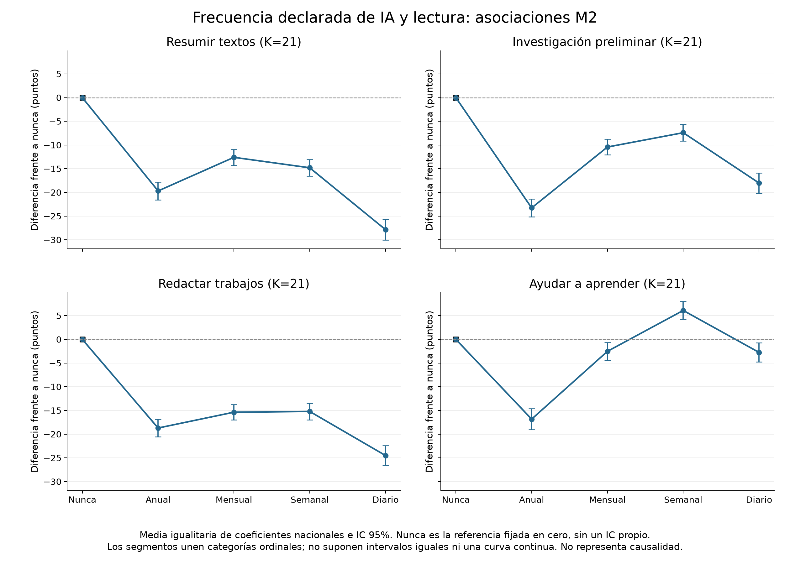
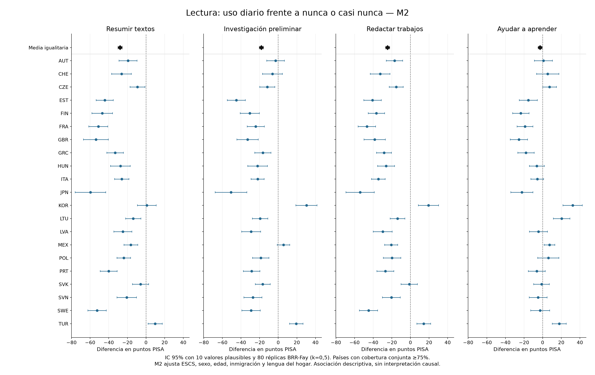

> Historical stage document. The current primary model is CORE (32 countries); see ../../README.md.

# ETAPA 2B — Varianza validada y análisis inicial de IA y PISA

**Estado: PASS WITH RESTRICTED ESTIMAND.** Se ejecutaron M0, M1 y M2. El STOP global de 2A queda superado por la aprobación del usuario y la validación empírica. El usuario confirmó mantener M2 completo y señalar países no estimables. **No se ejecutaron M3, M4, M5 ni LDW**, ni se construyó SUBSTITUTIVE_AI_INDEX.

**Resultado central:** en el conjunto fijo de **21 países con M2 completo y cobertura conjunta ≥75%**, las asociaciones en lectura de uso diario frente a nunca fueron −27.85 puntos para resumir, −18.02 para investigar y −24.50 para redactar. El uso diario quedó por debajo del semanal en las cuatro conductas y los tres dominios. Ayudar a aprender presenta un perfil diferente: semanal frente a nunca +6.10 puntos en lectura; la pequeña asociación negativa diaria frente a nunca **no resiste** umbrales de cobertura de 80–90%. Estos resultados describen asociaciones y no prueban que la IA cause cambios en rendimiento.

## Estimando, población y regla del 75%

Estimando solicitado: **«Asociación ponderada entre frecuencia declarada de uso de IA y rendimiento PISA entre estudiantes con respuestas válidas a ST438, en sistemas OCDE donde la variable analizada vincula al menos al 75% ponderado de la población objetivo PISA.»**

Se cita y aplica [PISA 2025 Technical Standard 6.15, página 30](https://www.oecd.org/content/dam/oecd/en/about/programmes/edu/pisa/publications/technical-standards/PISA_2025_Technical_Standards.pdf): análisis de cuestionario bajo el 75% ponderado deben marcarse o sustituirse por missing en informes OCDE. En este PUF se usa la suma nacional de W_FSTUWT de respondientes PISA como denominador operativo, sin eliminar primero UH ni códigos estructurales. No se equipara esa población escolar definida a todos los adolescentes de 15 años. Pasar 75% no garantiza ausencia de selección o confusión.

Se reverificaron **36** de 38 miembros que pasan el criterio de las cuatro ST438; **ISR y USA** quedan exclusivamente en el apéndice exploratorio. Para H6 se reverificaron **32** candidatos al añadir ST436Q16DA, excluyendo CAN/CHL/CRI/FRA/ISR/USA. H6 no se estimó en esta etapa.

M2 utiliza casos completos de exposición, outcome y todas las covariables. Su dominio observado es más estrecho que el de respondientes ST438 en general. No se imputa información ausente ni se considera que el umbral elimine ese problema. La media principal se denomina **promedio descriptivo igualitario de los 21 países elegibles M2**, no «resultado de la OCDE-38» ni una asociación universal.

## Validación empírica de Fay 2025

**FAY VALIDATION PASS — k=0.5 empirically reproduces published PISA 2025 SEs**

Se descargó el libro oficial del [StatLink mrq53f](https://stat.link/mrq53f), enlazado en el [Anexo B1 del volumen I](https://www.oecd.org/en/publications/pisa-2025-results-volume-i_73451bc5-en/full-report/results-for-countries-and-economies_33854635.html). Se compararon Tables I.B1.2a.1 ciencia, I.B1.2a.2 lectura e I.B1.2a.3 matemáticas en AUS/COL/DEU/JPN/MEX/TUR. Para esta comprobación se usa la población nacional PISA completa con PV válido; **no** se restringe a respondientes ST438.

Se calcularon diez medias por separado y, para cada PV, 80 medias replicadas. La varianza muestral es 1/20 Σ_r(θ_mr−θ_m)^2. Varianza total=promedio de varianzas muestrales +1.1×varianza entre diez estimaciones PV. Se incluyeron los estudiantes UH/PBA según su disponibilidad de PV y pesos; se excluyen únicamente códigos de missing oficiales del outcome.

El criterio previo fue igualdad al redondeo de las células oficiales: medias a entero y SE a una decimal. **18/18 pares pasan.** La coincidencia es aún más estrecha: diferencias máximas absolutas de media **0.000004894** puntos y SE **0.000004494** puntos respecto a valores subyacentes de cinco decimales. No se adoptó k por costumbre: su factor quedó contrastado empíricamente en 2025. El ZIP técnico permanece inaccesible por HTTP 403; ello se conserva como limitación de la confirmación textual, sin mantener el STOP que el usuario reemplazó por esta validación.

| País | Dominio | Media calculada | Media oficial | SE calculado | SE oficial | PASS |
|---|---|---|---|---|---|---|
| AUS | SCIE | 509.10633 | 509.10633 | 1.88528 | 1.88528 | True |
| AUS | READ | 490.86328 | 490.86328 | 1.85184 | 1.85184 | True |
| AUS | MATH | 477.52665 | 477.52665 | 1.91516 | 1.91516 | True |
| COL | SCIE | 413.73094 | 413.73094 | 3.29367 | 3.29367 | True |
| COL | READ | 399.26735 | 399.26735 | 3.30841 | 3.30841 | True |
| COL | MATH | 380.52867 | 380.52867 | 2.78141 | 2.78141 | True |
| DEU | SCIE | 485.52144 | 485.52144 | 3.52112 | 3.52112 | True |
| DEU | READ | 465.28206 | 465.28206 | 3.56221 | 3.56221 | True |
| DEU | MATH | 463.80565 | 463.80565 | 3.04616 | 3.04616 | True |
| JPN | SCIE | 537.58624 | 537.58624 | 3.80592 | 3.80592 | True |
| JPN | READ | 502.71450 | 502.71450 | 3.77783 | 3.77783 | True |
| JPN | MATH | 525.37580 | 525.37580 | 4.20407 | 4.20407 | True |
| MEX | SCIE | 413.56537 | 413.56537 | 2.00143 | 2.00143 | True |
| MEX | READ | 407.93756 | 407.93756 | 2.15977 | 2.15977 | True |
| MEX | MATH | 387.58717 | 387.58717 | 1.85817 | 1.85817 | True |
| TUR | SCIE | 494.26907 | 494.26907 | 2.30502 | 2.30502 | True |
| TUR | READ | 472.09549 | 472.09549 | 2.30625 | 2.30625 | True |
| TUR | MATH | 461.54657 | 461.54657 | 2.39744 | 2.39744 | True |

`fay2025_validation.csv` incluye medias, SE, componentes de varianza, códigos de país, población, células B/C, hoja, formato publicado y diferencias. El archivo oficial está archivado con SHA256 en `data/documentation/stage2b_official_manifest.json`.

## Modelos nacionales y combinación

M0 presenta porcentajes entre respuestas sustantivas 1–5 y medias de rendimiento por categoría, país y dominio, con diez PV y BRR-Fay. Su denominador de frecuencia **excluye no respuesta**; difiere deliberadamente del compendio de 2A que incluía código 99. No usar ambos porcentajes como si tuvieran el mismo denominador.

M1: intercepto + cuatro indicadores de frecuencia, referencia nunca/casi nunca. M2 añade ESCS, ST004D01T (sexo femenino/masculino del marco muestral), AGE, inmigración (categorías 2/3 frente a nativo) y lengua del hogar (otra lengua frente a idioma de prueba). No se incluyen dummies de país en los modelos nacionales. No se sustituyó sexo por un ítem no disponible del cuestionario. Las variables continuas se centraron en cada muestra para estabilidad; esto no cambia los contrastes de IA. Se documentan covariables constantes omitidas, sin suprimir controles ausentes para ampliar la muestra.

Cada modelo se reestimó con **10 PV ×81 pesos**. Se combinan matrices de covarianza, no solo SE individuales: U=media de covarianzas BRR-Fay y T=U+1.1B. Por eso el contraste diario−semanal conserva su covarianza. No se promedian PV por estudiante como outcome. IC normales bilaterales de 95% y p asintóticos; no errores OLS convencionales. Se ajustaron 456 modelos nacionales M1 y 276 M2, contando exposiciones y dominios e incluyendo los dos países del apéndice.

El promedio principal es β̄=Σβ_c/K y Var(β̄)=ΣT_c/K² para diseños nacionales independientes. No se perturban conjuntamente réplicas de países como si fueran un diseño único. Sus IC reflejan la incertidumbre muestral/PV del **conjunto fijo de países**; no incorporan una superpoblación de países. SENWT sigue en el reducido, pero no se ajustó aquí una regresión agrupada con senate weights.

La familia primaria incluye exactamente **60 pruebas M2**: 48 niveles frente a nunca y 12 diario frente a semanal. q_FDR se calcula conjuntamente mediante BH. Los p nacionales son descriptivos/exploratorios y no sustituyen esa familia. M1 y escenarios adicionales tienen correcciones separadas, etiquetadas secundarias.

## Cobertura conjunta y países no estimables

`model_joint_coverage.csv` contiene 38×4×3×4=1824 filas. `joint_linkage_pct` considera exposición, covariables requeridas y diez PV válidos del dominio. `below_75_joint_coverage=True` permanece visible aunque el país pase ST438 individualmente. Si hubiera un resultado estimable bajo 75%, se conservaría y excluiría solo de la síntesis primaria; las filas sin casos completos quedan con N=0 y coeficientes NA.

**M2 completo no puede estimarse en 15 candidatos:** AUS, BEL, CAN, CHL, COL, CRI, DEU, DNK, ESP, IRL, ISL, LUX, NLD, NOR y NZL. Sexo está ausente nacionalmente en doce; Costa Rica no tiene ESCS/IMMIG válidos; Luxemburgo y Noruega no tienen AGE válido. Esas ausencias no significan que los alumnos carezcan de esas características. La decisión confirmada por el usuario conserva todos los controles y registra la imposibilidad, sin reconstruir atributos desde otras fuentes.

Los 21 países principales M2 son **AUT, CHE, CZE, EST, FIN, FRA, GBR, GRC, HUN, ITA, JPN, KOR, LTU, LVA, MEX, POL, PRT, SVK, SVN, SWE, TUR**. Todos los contrastes primarios tienen K=21. La tabla siguiente muestra cobertura conjunta de lectura (los tres dominios quedan documentados en CSV):

| País | Resumir % | Investigar % | Redactar % | Aprender % | Estado M2 | Covariables nacionales ausentes |
|---|---|---|---|---|---|---|
| AUS | 0.00 | 0.00 | 0.00 | 0.00 | no estimable: covariables ausentes | ST004D01T |
| AUT | 87.26 | 87.01 | 86.84 | 86.94 | incluido en síntesis M2 | ninguna ausente por completo |
| BEL | 0.00 | 0.00 | 0.00 | 0.00 | no estimable: covariables ausentes | ST004D01T |
| CAN | 0.00 | 0.00 | 0.00 | 0.00 | no estimable: covariables ausentes | ST004D01T |
| CHE | 79.88 | 79.45 | 79.27 | 79.48 | incluido en síntesis M2 | ninguna ausente por completo |
| CHL | 0.00 | 0.00 | 0.00 | 0.00 | no estimable: covariables ausentes | ST004D01T |
| COL | 0.00 | 0.00 | 0.00 | 0.00 | no estimable: covariables ausentes | ST004D01T |
| CRI | 0.00 | 0.00 | 0.00 | 0.00 | no estimable: covariables ausentes | ESCS, IMMIG |
| CZE | 86.23 | 85.88 | 85.72 | 85.67 | incluido en síntesis M2 | ninguna ausente por completo |
| DEU | 0.00 | 0.00 | 0.00 | 0.00 | no estimable: covariables ausentes | ST004D01T |
| DNK | 0.00 | 0.00 | 0.00 | 0.00 | no estimable: covariables ausentes | ST004D01T |
| ESP | 0.00 | 0.00 | 0.00 | 0.00 | no estimable: covariables ausentes | ST004D01T |
| EST | 94.24 | 94.20 | 94.09 | 94.04 | incluido en síntesis M2 | ninguna ausente por completo |
| FIN | 88.06 | 87.83 | 87.74 | 87.67 | incluido en síntesis M2 | ninguna ausente por completo |
| FRA | 75.97 | 75.59 | 75.54 | 75.30 | incluido en síntesis M2 | ninguna ausente por completo |
| GBR | 80.25 | 79.95 | 79.91 | 79.79 | incluido en síntesis M2 | ninguna ausente por completo |
| GRC | 87.72 | 87.37 | 87.39 | 87.13 | incluido en síntesis M2 | ninguna ausente por completo |
| HUN | 91.98 | 91.79 | 91.71 | 91.53 | incluido en síntesis M2 | ninguna ausente por completo |
| IRL | 0.00 | 0.00 | 0.00 | 0.00 | no estimable: covariables ausentes | ST004D01T |
| ISL | 0.00 | 0.00 | 0.00 | 0.00 | no estimable: covariables ausentes | ST004D01T |
| ISR | 51.46 | 51.15 | 51.10 | 50.78 | apéndice, cobertura ST438 insuficiente | ninguna ausente por completo |
| ITA | 92.27 | 92.03 | 92.02 | 91.82 | incluido en síntesis M2 | ninguna ausente por completo |
| JPN | 94.01 | 93.88 | 93.71 | 93.75 | incluido en síntesis M2 | ninguna ausente por completo |
| KOR | 95.86 | 95.81 | 95.68 | 95.84 | incluido en síntesis M2 | ninguna ausente por completo |
| LTU | 82.20 | 81.95 | 81.83 | 81.52 | incluido en síntesis M2 | ninguna ausente por completo |
| LUX | 0.00 | 0.00 | 0.00 | 0.00 | no estimable: covariables ausentes | AGE |
| LVA | 79.42 | 79.01 | 79.07 | 78.96 | incluido en síntesis M2 | ninguna ausente por completo |
| MEX | 89.84 | 89.71 | 89.58 | 88.52 | incluido en síntesis M2 | ninguna ausente por completo |
| NLD | 0.00 | 0.00 | 0.00 | 0.00 | no estimable: covariables ausentes | ST004D01T |
| NOR | 0.00 | 0.00 | 0.00 | 0.00 | no estimable: covariables ausentes | AGE |
| NZL | 0.00 | 0.00 | 0.00 | 0.00 | no estimable: covariables ausentes | ST004D01T |
| POL | 87.55 | 87.30 | 87.09 | 86.98 | incluido en síntesis M2 | ninguna ausente por completo |
| PRT | 87.81 | 87.57 | 87.60 | 87.41 | incluido en síntesis M2 | ninguna ausente por completo |
| SVK | 86.40 | 86.18 | 85.90 | 85.78 | incluido en síntesis M2 | ninguna ausente por completo |
| SVN | 85.83 | 85.69 | 85.44 | 85.45 | incluido en síntesis M2 | ninguna ausente por completo |
| SWE | 79.06 | 78.68 | 78.25 | 78.45 | incluido en síntesis M2 | ninguna ausente por completo |
| TUR | 92.90 | 92.66 | 92.56 | 92.21 | incluido en síntesis M2 | ninguna ausente por completo |
| USA | 50.25 | 50.07 | 49.82 | 50.01 | apéndice, cobertura ST438 insuficiente | ninguna ausente por completo |

La cobertura M3/M5 es **solo prospectiva**: M3=M2+controles digitales predefinidos; M5 candidato=M2+ST436Q16DA para una futura interacción. No se estimaron esos modelos, ni se incorporan covariables escolares aún no fijadas. Estos porcentajes no certifican la muestra de otra especificación M5 posterior.

## Resultados principales en lectura

| Conducta | Contraste | β puntos | SE | IC 95% | q BH60 | K | % β nacional <0 |
|---|---|---|---|---|---|---|---|
| Resumir | Anual − nunca | -19.69 | 0.96 | [-21.57, -17.81] | 3.72e-93 | 21 | 100.0 |
| Resumir | Mensual − nunca | -12.60 | 0.86 | [-14.29, -10.92] | 2.39e-48 | 21 | 90.5 |
| Resumir | Semanal − nunca | -14.80 | 0.90 | [-16.56, -13.05] | 5.68e-61 | 21 | 85.7 |
| Resumir | Diario − nunca | -27.85 | 1.11 | [-30.02, -25.68] | 8.16e-138 | 21 | 90.5 |
| Resumir | Diario − semanal | -13.05 | 1.12 | [-15.25, -10.84] | 6.29e-31 | 21 | 90.5 |
| Investigar | Anual − nunca | -23.27 | 0.97 | [-25.17, -21.37] | 2.6e-126 | 21 | 100.0 |
| Investigar | Mensual − nunca | -10.42 | 0.84 | [-12.08, -8.77] | 7.28e-35 | 21 | 81.0 |
| Investigar | Semanal − nunca | -7.40 | 0.89 | [-9.14, -5.67] | 8.7e-17 | 21 | 76.2 |
| Investigar | Diario − nunca | -18.02 | 1.09 | [-20.16, -15.88] | 1.8e-60 | 21 | 85.7 |
| Investigar | Diario − semanal | -10.62 | 1.12 | [-12.80, -8.43] | 2.62e-21 | 21 | 90.5 |
| Redactar | Anual − nunca | -18.70 | 0.93 | [-20.53, -16.88] | 4.01e-89 | 21 | 100.0 |
| Redactar | Mensual − nunca | -15.37 | 0.83 | [-17.00, -13.74] | 1.37e-75 | 21 | 90.5 |
| Redactar | Semanal − nunca | -15.21 | 0.89 | [-16.95, -13.47] | 5.07e-65 | 21 | 85.7 |
| Redactar | Diario − nunca | -24.50 | 1.06 | [-26.58, -22.43] | 7.37e-118 | 21 | 90.5 |
| Redactar | Diario − semanal | -9.29 | 1.09 | [-11.44, -7.15] | 2.29e-17 | 21 | 95.2 |
| Aprender | Anual − nunca | -16.83 | 1.12 | [-19.03, -14.63] | 1.6e-50 | 21 | 100.0 |
| Aprender | Mensual − nunca | -2.52 | 0.96 | [-4.40, -0.64] | 0.0089 | 21 | 61.9 |
| Aprender | Semanal − nunca | 6.10 | 0.96 | [4.22, 7.98] | 2.51e-10 | 21 | 19.0 |
| Aprender | Diario − nunca | -2.75 | 1.03 | [-4.77, -0.73] | 0.00813 | 21 | 61.9 |
| Aprender | Diario − semanal | -8.85 | 0.90 | [-10.62, -7.09] | 1.36e-22 | 21 | 90.5 |

El uso anual presenta asociaciones más negativas que algunas frecuencias moderadas, lo que impide describir el patrón como una caída lineal universal. Las categorías declaradas no están espaciadas uniformemente en tiempo. «Resumir/investigar/redactar» tampoco demuestran sustitución efectiva de procesos cognitivos.

## Resultados por dominio y diario frente a semanal

Uso diario frente a nunca, en los tres dominios:

| Conducta | Dominio | Diario − nunca | IC 95% | q BH60 | I² % |
|---|---|---|---|---|---|
| Resumir | READ | -27.85 | [-30.02, -25.68] | 8.16e-138 | 93.1 |
| Resumir | MATH | -22.64 | [-24.72, -20.55] | 1.64e-99 | 90.0 |
| Resumir | SCIE | -28.78 | [-30.90, -26.66] | 3.49e-154 | 92.4 |
| Investigar | READ | -18.02 | [-20.16, -15.88] | 1.8e-60 | 93.5 |
| Investigar | MATH | -14.38 | [-16.52, -12.24] | 2.42e-39 | 91.0 |
| Investigar | SCIE | -18.28 | [-20.37, -16.19] | 3.48e-65 | 93.6 |
| Redactar | READ | -24.50 | [-26.58, -22.43] | 7.37e-118 | 93.3 |
| Redactar | MATH | -19.75 | [-21.79, -17.71] | 1.55e-79 | 90.8 |
| Redactar | SCIE | -25.37 | [-27.41, -23.33] | 8.67e-130 | 92.5 |
| Aprender | READ | -2.75 | [-4.77, -0.73] | 0.00813 | 90.5 |
| Aprender | MATH | -2.22 | [-4.17, -0.26] | 0.0267 | 88.5 |
| Aprender | SCIE | -5.28 | [-7.27, -3.29] | 2.31e-07 | 90.1 |

Diario frente a semanal, usando la covarianza completa:

| Conducta | Dominio | Diario − semanal | IC 95% | q BH60 | % β <0 | I² % |
|---|---|---|---|---|---|---|
| Resumir | READ | -13.05 | [-15.25, -10.84] | 6.29e-31 | 90.5 | 54.7 |
| Resumir | MATH | -9.86 | [-12.00, -7.72] | 2.11e-19 | 90.5 | 38.5 |
| Resumir | SCIE | -12.52 | [-14.65, -10.40] | 1.42e-30 | 90.5 | 40.5 |
| Investigar | READ | -10.62 | [-12.80, -8.43] | 2.62e-21 | 90.5 | 68.5 |
| Investigar | MATH | -8.31 | [-10.44, -6.18] | 2.63e-14 | 85.7 | 57.3 |
| Investigar | SCIE | -9.87 | [-11.98, -7.77] | 5.5e-20 | 90.5 | 62.4 |
| Redactar | READ | -9.29 | [-11.44, -7.15] | 2.29e-17 | 95.2 | 52.6 |
| Redactar | MATH | -7.29 | [-9.39, -5.19] | 1.22e-11 | 85.7 | 56.9 |
| Redactar | SCIE | -8.85 | [-10.93, -6.77] | 1e-16 | 90.5 | 52.0 |
| Aprender | READ | -8.85 | [-10.62, -7.09] | 1.36e-22 | 90.5 | 66.9 |
| Aprender | MATH | -7.42 | [-9.13, -5.70] | 3.32e-17 | 85.7 | 54.5 |
| Aprender | SCIE | -8.76 | [-10.47, -7.04] | 2.27e-23 | 90.5 | 66.7 |

Los doce contrastes diario−semanal son negativos y pasan BH60; la proporción de coeficientes nacionales negativos es aproximadamente 86–95%. No implica que reducir la frecuencia de un mismo alumno produciría ese cambio de puntaje: las categorías corresponden a estudiantes diferentes.

## Heterogeneidad y comparación con otros usos

| Conducta | Rango nacional diario − nunca, lectura | % negativo | I² % | REML secundario β | IC modificado HK |
|---|---|---|---|---|---|
| Resumir | [-59.65, 9.81] | 90.5 | 93.1 | -27.47 | [-36.07, -18.88] |
| Investigar | [-50.77, 30.32] | 85.7 | 93.5 | -17.76 | [-26.44, -9.09] |
| Redactar | [-54.01, 19.33] | 90.5 | 93.3 | -24.31 | [-32.69, -15.92] |
| Aprender | [-25.49, 32.23] | 61.9 | 90.5 | -2.72 | [-9.59, 4.14] |

La heterogeneidad de diario frente a nunca es alta (I² cercano a 89–94%). Hay países con coeficientes positivos, especialmente Corea y Türkiye en varios usos. No se presenta la media como consenso de todos los sistemas. El meta-análisis REML con IC modificado Hartung–Knapp es secundario; cambia ponderación y estimando, y no reemplaza la media igualitaria solicitada.

Para H4 se compararon los vectores de cuatro coeficientes de aprender con cada otra conducta, conservando la covarianza obtenida de las mismas réplicas y PV nacionales. Se usan países elegibles comunes y varianzas nacionales independientes. Nueve pruebas Wald secundarias tienen una familia BH9 separada de las 60 primarias:

| Aprender frente a | Dominio | Wald χ²(4) | q BH9 secundario | K |
|---|---|---|---|---|
| Resumir | READ | 984.16 | 8.7e-211 | 21 |
| Resumir | MATH | 739.73 | 1.56e-158 | 21 |
| Resumir | SCIE | 921.10 | 1.34e-197 | 21 |
| Investigar | READ | 374.03 | 1.46e-79 | 21 |
| Investigar | MATH | 260.28 | 3.97e-55 | 21 |
| Investigar | SCIE | 303.37 | 2.28e-64 | 21 |
| Redactar | READ | 936.74 | 8.22e-201 | 21 |
| Redactar | MATH | 716.82 | 1.19e-153 | 21 |
| Redactar | SCIE | 877.76 | 2.47e-188 | 21 |

Las diferencias de patrón permanecen en los siete escenarios de selección. Esta comparación utiliza muestras respondientes específicas de cada exposición y controles comunes; no identifica que un propósito sea causalmente mejor ni mide una intervención de alfabetización crítica.

Para H5 hay evidencia de contrastes no uniformes, pero la versión «uso moderado mejora/neutral, diario deteriora» **no se sostiene de forma general para las cuatro conductas**. En resumir e investigar/redactar, el uso mensual/semanal también se asocia negativamente con lectura respecto a nunca. En aprender, el semanal es positivo (+6.10) y diario−semanal negativo (−8.85), pero diario−nunca es pequeño y no robusto al elevar cobertura. No se declara una U ni U invertida por mirar el gráfico.

## Sensibilidades de selección completas

Se conservan los siete escenarios solicitados: A ≥75%, B ≥80%, C ≥85%, D ≥90%, E ≥75% excluyendo UH>5%, F ≥75% sin registros UH observados y G todos los ≥75%. Los umbrales se aplican a la **cobertura conjunta del modelo/exposición/dominio**; la lista inicial exige además >=75% en las cuatro ST438. Los países de cada escenario están en CSV; los cambios combinan selección nacional y cobertura, no son una corrección estimada de sesgo.

| Escenario | Conducta | Diario − nunca | IC 95% | q BH60 escenario | K |
|---|---|---|---|---|---|
| A_75 | Resumir | -27.85 | [-30.02, -25.68] | 8.16e-138 | 21 |
| A_75 | Investigar | -18.02 | [-20.16, -15.88] | 1.8e-60 | 21 |
| A_75 | Redactar | -24.50 | [-26.58, -22.43] | 7.37e-118 | 21 |
| A_75 | Aprender | -2.75 | [-4.77, -0.73] | 0.00813 | 21 |
| B_80 | Resumir | -25.28 | [-27.69, -22.88] | 6.65e-93 | 17 |
| B_80 | Investigar | -16.06 | [-18.48, -13.65] | 2.01e-38 | 16 |
| B_80 | Redactar | -20.13 | [-22.43, -17.82] | 9.27e-65 | 16 |
| B_80 | Aprender | -0.72 | [-2.97, 1.54] | 0.552 | 16 |
| C_85 | Resumir | -24.15 | [-26.67, -21.63] | 1.09e-77 | 15 |
| C_85 | Investigar | -15.84 | [-18.35, -13.32] | 1.67e-34 | 15 |
| C_85 | Redactar | -20.54 | [-22.94, -18.13] | 5.6e-62 | 15 |
| C_85 | Aprender | -2.12 | [-4.45, 0.21] | 0.0774 | 15 |
| D_90 | Resumir | -24.47 | [-28.84, -20.10] | 1.01e-26 | 6 |
| D_90 | Investigar | -15.08 | [-19.57, -10.58] | 1.36e-10 | 6 |
| D_90 | Redactar | -20.27 | [-24.46, -16.08] | 2.07e-20 | 6 |
| D_90 | Aprender | 0.05 | [-3.71, 3.80] | 0.981 | 6 |
| E_UH_le_5 | Resumir | -27.85 | [-30.02, -25.68] | 8.16e-138 | 21 |
| E_UH_le_5 | Investigar | -18.02 | [-20.16, -15.88] | 1.8e-60 | 21 |
| E_UH_le_5 | Redactar | -24.50 | [-26.58, -22.43] | 7.37e-118 | 21 |
| E_UH_le_5 | Aprender | -2.75 | [-4.77, -0.73] | 0.00813 | 21 |
| F_no_UH_observed | Resumir | -31.17 | [-33.62, -28.72] | 1.65e-135 | 17 |
| F_no_UH_observed | Investigar | -18.82 | [-21.26, -16.38] | 2.4e-51 | 17 |
| F_no_UH_observed | Redactar | -27.09 | [-29.43, -24.74] | 2.32e-112 | 17 |
| F_no_UH_observed | Aprender | -3.53 | [-5.80, -1.26] | 0.00246 | 17 |
| G_all_75 | Resumir | -27.85 | [-30.02, -25.68] | 8.16e-138 | 21 |
| G_all_75 | Investigar | -18.02 | [-20.16, -15.88] | 1.8e-60 | 21 |
| G_all_75 | Redactar | -24.50 | [-26.58, -22.43] | 7.37e-118 | 21 |
| G_all_75 | Aprender | -2.75 | [-4.77, -0.73] | 0.00813 | 21 |

Las asociaciones negativas diarias de resumir, investigar y redactar permanecen en lectura en todos los escenarios. Al subir a 80–90% su magnitud se reduce, pero su signo y los IC negativos persisten. En **aprender**, la asociación negativa diaria frente a nunca **desaparece como evidencia estable**: q=.552 a 80%, .077 a 85% y .981 a 90%; a 90% β≈0.05. Este resultado no se oculta ni se escoge el umbral favorable.

Los doce contrastes diario−semanal permanecen negativos y con q<.05 en los siete escenarios; incluso a 90% el mayor q es 0.000304. Sin embargo, K pasa de 21 a 16–17 (80%), 15 (85%) y solo 6 (90%). La estabilidad a 90% describe esos seis países, no permite volver a generalizar a los 36 iniciales.

E no modifica M2: todos los países con UH>5% ya carecen de M2 completo. Por tanto, E **no es evidencia independiente** de que UH no importe. F reduce K a 17 y conserva las asociaciones negativas principales. A y G son idénticos por definición; no se cuentan como dos comprobaciones independientes. Las sensibilidades M1 también se entregan en el CSV para no ocultar el comportamiento en un conjunto de países más amplio.

## Colombia y países de cobertura insuficiente

Colombia pasa las cuatro ST438 (aproximadamente 87.12–88.58%) y está incluida normalmente en M0/M1. **ST436Q16DA=75.65827%**: pasa 75%, pero **no pasa 80%**. Se marca como cercana al límite en los diagnósticos de H6; no se ajustó la interacción, por lo que no hay un resultado H6 que comparar todavía. Su cobertura conjunta M5 candidata es 0% con los controles completos por ausencia de sexo.

M2 colombiano completo no es estimable; queda explícito en las tablas nacionales y no se reemplaza por un modelo de menos controles. Para mostrar la información disponible, sus asociaciones **M1 no ajustadas**, lectura, son:

| Conducta | Contraste M1 | β lectura | IC 95% sin ajuste FDR nacional | Cobertura % |
|---|---|---|---|---|
| Resumir | Diario − nunca | 2.89 | [-8.21, 13.98] | 88.58 |
| Resumir | Diario − semanal | -17.52 | [-27.91, -7.14] | 88.58 |
| Investigar | Diario − nunca | 35.69 | [24.45, 46.92] | 87.99 |
| Investigar | Diario − semanal | -13.65 | [-21.18, -6.11] | 87.99 |
| Redactar | Diario − nunca | -6.16 | [-15.57, 3.26] | 87.58 |
| Redactar | Diario − semanal | -13.47 | [-22.20, -4.74] | 87.58 |
| Aprender | Diario − nunca | 43.66 | [31.51, 55.81] | 87.12 |
| Aprender | Diario − semanal | -4.67 | [-11.66, 2.33] | 87.12 |

Estas diferencias nacionales —incluidas asociaciones positivas para investigar/aprender frente a nunca— se reportan sin usarlas como prueba causal ni como sustituto del M2 que falta. Demuestran por qué conviene distinguir conducta, controles, país y comparación de frecuencia.

ISR/USA permanecen en `low_coverage_exploratory_ISR_USA.csv`, con indicadores de cobertura insuficiente y alcance exploratorio. No entran en ningún promedio principal ni sensibilidad principal, ni se utilizan para confirmar o rechazar H1–H5. Sus registros originales no se eliminaron.

## Verificación y reproducción

Los 18 controles oficiales pasan; las categorías y pesos nacionales se concilian. Nueve estimaciones independientes por SVD ponderada, en AUT/MEX/FRA con distintos dominios, exposiciones y pesos final/réplicas, coinciden con los coeficientes del cálculo por lotes con diferencia máxima **1.83e-12**. Se verificaron medias igualitarias, suma de varianzas nacionales, N, pesos, separación ISR/USA, identidad A/G y BH60 mediante una implementación independiente de SciPy. Las dos figuras fueron revisadas visualmente.

Protocolo antes de M2: `STAGE_2B_PLAN.md`; secuencia desde outputs:

    python scripts/2b_download_official.py
    python scripts/2b_validate_fay.py
    python scripts/2b_national_models.py --models M0 M1
    python scripts/2b_national_models.py --models M2
    python scripts/2b_synthesize.py
    python scripts/2b_figures.py
    python scripts/2b_check_results.py
    python scripts/2b_report.py

Los archivos NPZ de estimaciones finales/replicadas de cada PV permiten reconstruir contrastes y covarianzas. No incluyen atributos adicionales de personas; los scripts no llaman servicios externos para analizar los registros. Paquetes y decisiones están en `results/package_versions.json` y `RESEARCH_LOG.md`.

| Entregable | Contenido |
|---|---|
| ../../results/validation/fay2025_validation.csv | 18 pares media/SE oficiales; células y formatos originales |
| ../../results/aggregated/model_joint_coverage.csv | 1824 combinaciones país/exposición/dominio/M1-M2-M3-M5; M3/M5 solo prospectivo |
| ../../results/aggregated/descriptives_M0.csv | 2280 filas nacionales por categoría, dominio y exposición; incluye apéndice marcado |
| ../../results/aggregated/country_effects_M1.csv | 2160 contrastes en los 36 candidatos nacionales |
| ../../results/aggregated/country_effects_M2.csv | 2160 filas; incluye no estimables, sin inventar coeficientes |
| ../../results/aggregated/oecd_equal_weight_summary_M2.csv | 60 contrastes, K, muestra, cobertura, rango, signos y heterogeneidad |
| ../../results/aggregated/primary_contrasts_M2.csv | Misma síntesis principal con q BH60 |
| ../../results/robustness/selection_sensitivity.csv | 840 filas: 7 escenarios ×60 contrastes×M1/M2 |
| ../../results/aggregated/low_coverage_exploratory_ISR_USA.csv | M1/M2 de ISR/USA, exclusivamente exploratorios |
| figures/forest_reading_summary.png | Diario frente a nunca: efectos nacionales y media igualitaria M2 |
| figures/ai_frequency_reading.png | Perfiles categóricos M2 e IC; no curva causal |
| ../../results/robustness/secondary_REML_M2.csv | Meta-análisis REML secundario e IC modificado Hartung–Knapp |
| ../../results/robustness/learn_vs_other_pattern_tests_M2.csv | 9 pruebas Wald secundarias, covarianza entre modelos y BH9 |
| ../../results/robustness/learn_vs_other_pattern_sensitivity_M2.csv | Las mismas pruebas de patrones en los 7 escenarios |
| ../../results/aggregated/stage2b_covariate_availability.csv | Ausencia nacional de covariables obligatorias |
| results/stage2b_quality_checks.json | Reconciliación de cobertura, varianza, FDR y 9 cálculos SVD independientes |

## Conclusión de hipótesis

«supported» se restringe al estimando y conjunto de países descritos. Se exige signo, magnitud, IC/FDR, predominio nacional y las sensibilidades completas; no se decide solo por p<.05. La selección por respondientes, casos completos, autoinforme, confusión residual y causalidad inversa siguen limitando la interpretación. Los resultados no permiten atribuir un efecto de sustitución cognitiva a la IA.

| Hipótesis | Resultado | Evidencia | Robustez |
|---|---|---|---|
| H1: resumir y menor lectura | supported, en el estimando restringido M2 | Diario−nunca −27.85, IC [−30.02, −25.68]; 19/21 coeficientes negativos; otros niveles también negativos en la media | Signo/magnitud negativos en 75/80/85/90%, UH≤5% y sin UH; heterogeneidad alta y 15 países sin M2 completo |
| H2: redactar y menor lectura | supported, en el estimando restringido M2 | Diario−nunca −24.50, IC [−26.58, −22.43]; 19/21 negativos; BH60 e IC respaldan asociación | Persiste con todos los escenarios; no consenso universal ni efecto causal |
| H3: diario inferior a semanal | supported, en el estimando restringido M2 | Los 12 contrastes son negativos, con BH60; lectura: −13.05 resumir, −10.62 investigar, −9.29 redactar, −8.85 aprender | Los 12 pasan en los siete escenarios; >=90% solo representa 6 países |
| H4: aprender presenta patrón diferente | supported como diferencia descriptiva de patrones | Semanal−nunca lectura +6.10 frente a medias negativas de otras conductas; 9 pruebas Wald con BH9 | Diferencias de patrón persisten por cobertura/UH; la pequeña asociación negativa diaria−nunca de aprender no es robusta |
| H5: mejora/neutralidad moderada y deterioro diario | mixed | Aprender semanal es positivo y diario−semanal negativo; las otras conductas ya son negativas con uso moderado | No patrón general de U/U invertida; diario−nunca de aprender pierde evidencia al subir cobertura a 80–90% |
