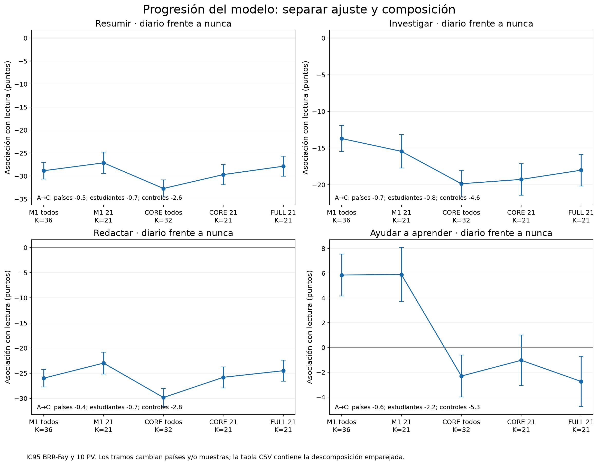
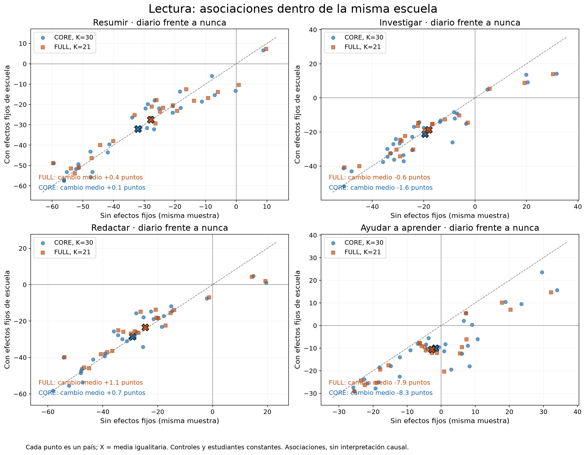
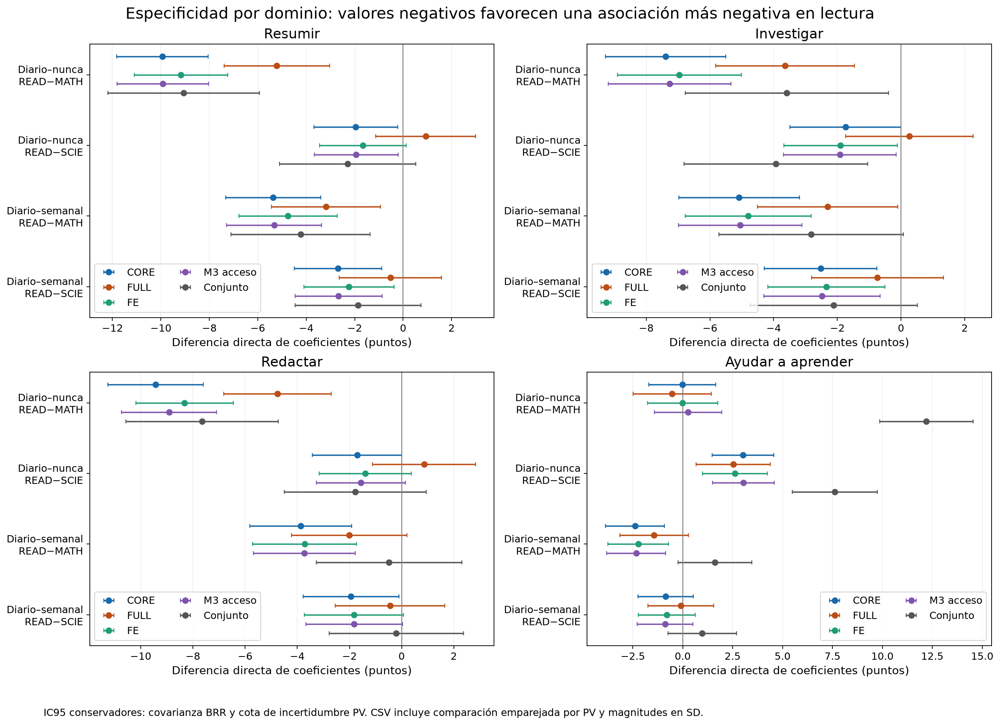
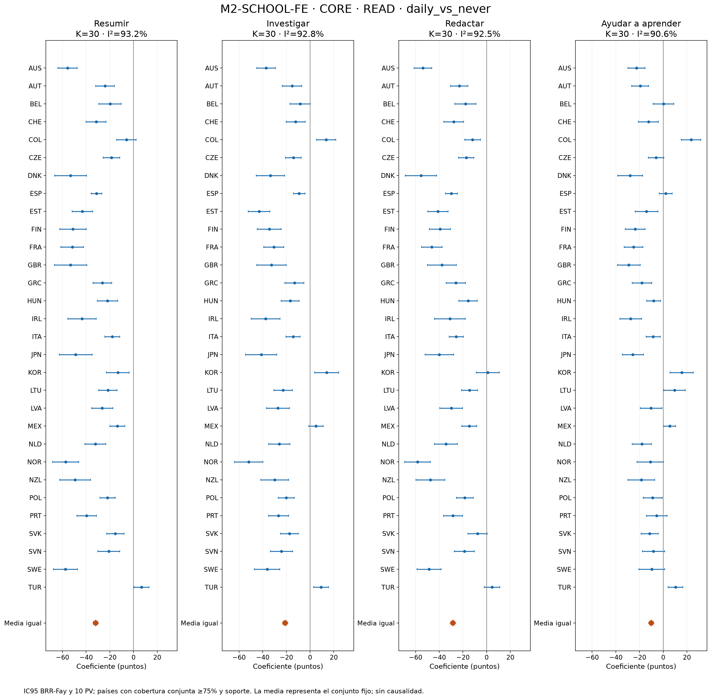

> Historical stage document. The current primary model is CORE (32 countries); see ../../README.md.

# ETAPA 2C — Robustez, confusión y mecanismo

Estado: **COMPLETE — PASS WITH RESTRICTED ESTIMAND**. Fecha: 2026-10-06, America/Bogota. La validación estadística pasó. No se ha analizado LDW ni redactado el artículo final.

La explicación específica de sustitución cognitiva **permanece indeterminada frente a selección/causalidad inversa**. Las nuevas pruebas fortalecen la robustez de las asociaciones condicionales de resumir/redactar y debilitan una explicación basada exclusivamente en diferencias entre escuelas o acceso digital. No satisfacen todos los criterios predefinidos para atribuir mayor plausibilidad específica al mecanismo: la diferencia frente a ciencias no es robusta en FULL, la comparación aprender cambia con FE y ciertos comportamientos digitales también muestran asociaciones negativas. Selección y confusión residual continúan siendo explicaciones importantes compatibles con los datos; ningún diagnóstico identifica la dirección causal.

## Estimando y decisiones anteriores a los coeficientes

Asociaciones nacionales ponderadas entre frecuencia autorreportada y rendimiento entre respondientes válidos a ST438 con covariables observadas, en sistemas OCDE candidatos con >=75% ponderado en los cuatro ítems y cobertura conjunta >=75% para la especificación. No representa automáticamente toda la población PISA ni todos los jóvenes de 15 años. ISR/USA permanecen fuera del conjunto principal aprobado. CORE conserva tres confusores de contexto —ESCS, IMMIG y lengua doméstica— por disponibilidad y justificación, sin escoger por signo o significancia. FULL conserva ESCS, sexo del marco ST004D01T, AGE, IMMIG y lengua doméstica. Las decisiones y criterios se registran en STAGE_2C_PLAN.md y results/stage2c_specification.json.

ESCS e IMMIG están disponibles en 35/36 sistemas y lengua doméstica en 36/36; sexo supera 75% solo en 24/36, con ausencia total en 12; AGE desaparece en LUX/NOR. Añadir edad al núcleo por obligatoriedad impediría recuperar esos dos sistemas, dentro de un intervalo etario estrecho. Sexo puede ser un confusor relevante que CORE no controla: el núcleo gana comparabilidad, no sustituye la sensibilidad FULL. No se elimina migración/lengua únicamente para rescatar CRI, donde ESCS/IMMIG están ausentes.

| candidate | countries_75 | nationally_absent | min_pct | median_pct |
| --- | --- | --- | --- | --- |
| AGE | 34 | 2 | 0 | 100 |
| ESCS | 35 | 1 | 0 | 93.7 |
| IMMIG | 35 | 1 | 0 | 93.9 |
| ST004D01T | 24 | 12 | 0 | 100 |
| ST022Q01TA | 36 | 0 | 89.4 | 97.3 |

CORE se estima en 35 países; su síntesis incluye **32**, porque CAN/CHL/DEU no alcanzan 75% conjunto, además de CRI no estimable. FULL mantiene **21** y reproduce los 1.260 contrastes 2B: diferencia máxima beta 5e-11, SE 5e-12. Las filas bajo cobertura o no estimables se conservan con flags y NA.

## Varianza y verificación

Cada especificación nacional se reestima con W_FSTUWT y 80 W_FSTURWT, para los diez PV de READ/MATH/SCIE. Para vector theta: U = media_m[sum_r(delta_mr delta_mr′)/20], B = cov_m(theta_m0), T = U + 1.1 B. No se regresa sobre la media individual de PV. El mismo X admite 30 respuestas como RHS, sin mezclarlas: es álgebra equivalente a 30 ajustes separados. Media igualitaria nacional, Var(media)=sum(T_c)/K²; no se agrupan réplicas independientes de distintos países. Se conserva SENWT en el reducido; la síntesis principal usa coeficientes nacionales iguales.

BH controla por separado todos los contrastes exposición/dominio/frecuencia de cada modelo/base (60 para cuatro usos IA), 16 diferencias de dominio y nueve pruebas de patrones. Todas las nuevas hipótesis son secundarias de 2C; las familias separadas no controlan un error global de todas las etapas. IC normales de 95%; equivalencia H15 usa IC90 y margen +/-5 puntos fijado antes de revisar los nuevos coeficientes. Q/I² y REML-Hartung–Knapp modificada son secundarios; la incertidumbre de la media igualitaria corresponde al conjunto fijo de países.

Verificación independiente: 9 ajustes con QR e indicadores explícitos de escuela, AUT/MEX/FRA, PV/réplicas distintos; error máximo 7.07e-13. Prueba sintética con pesos que cambian dentro de cada escuela: absorción correcta error 4.88e-13; reutilizar la transformación del peso final produce un error de 0.295 puntos. FDR, cobertura, NA, resúmenes nacionales y descomposición se comprobaron independientemente.

## Separar países, estudiantes y controles: A–E

| Uso | A_M1_36_beta | B_M1_21_beta | C_M2_CORE_all_eligible_beta | D_M2_CORE_21_beta | E_M2_FULL_21_beta |
| --- | --- | --- | --- | --- | --- |
| Resumir | -28.8 | -27.1 | -32.7 | -29.7 | -27.9 |
| Investigar | -13.7 | -15.5 | -19.9 | -19.3 | -18 |
| Redactar | -26 | -23 | -29.8 | -25.8 | -24.5 |
| Ayudar a aprender | 5.85 | 5.89 | -2.31 | -1.04 | -2.75 |

A=M1 36 países; B=M1 exactamente los 21 FULL; C=CORE 32 elegibles; D=CORE exactamente esos 21; E=FULL 21. Estos cinco números no bastan para atribuir un cambio a controles: también cambian respondientes. Se reestimó M1 sobre los casos completos de CORE y FULL y CORE sobre los mismos casos FULL.

| Uso | A_to_C_country_component | A_to_C_student_selection_component | A_to_C_controls_same_students_component | A_to_C_total |
| --- | --- | --- | --- | --- |
| Resumir | -0.55 | -0.667 | -2.64 | -3.86 |
| Investigar | -0.713 | -0.84 | -4.61 | -6.17 |
| Redactar | -0.38 | -0.697 | -2.77 | -3.85 |
| Ayudar a aprender | -0.624 | -2.24 | -5.3 | -8.17 |

Las tres columnas suman exactamente el cambio A→C. En resumir diario, cambiar a los 21 países por sí solo desplaza M1 de -28.83 a -27.12 (+1.71); en redactar, de -25.99 a -22.99 (+3.00). En cambio, ajustar CORE sobre los mismos estudiantes amplía la asociación negativa promedio: no toda atenuación/expansión es selección de países. ../../results/aggregated/model_progression_same_sample.csv contiene las 60 progresiones, N/K, listas, IC y cambios emparejados. Esta es una descomposición descriptiva, no una descomposición de sesgo causal.

## Efectos fijos de escuela: prueba prioritaria

Se usa CNT+CNTSCHID y absorción ponderada. Por cada réplica: G=X′WX−sum_s(X_s′w_s)(w_s′X_s)/sum_s(w_s) y R=X′WY−sum_s(X_s′w_s)(w_s′Y_s)/sum_s(w_s). Se recalculan sumas y denominadores escolares con cada peso; las medias de Y son distintas para cada PV. Esto equivale a Frisch–Waugh–Lovell con transformación within. No se reutiliza una única transformación del peso final.

Se exige >=30 escuelas informativas, >=30 alumnos en cada categoría y rango/condición suficiente en las 81 estimaciones. Las escuelas sin variación se registran y conservan: no identifican directamente los indicadores IA, pero pueden informar controles con variación interna. Se publica por escuela la varianza ordinal ponderada, categorías y alumnos; también el número de escuelas donde cada nivel coincide con nunca. El soporte de grafo completo se confirma por rango del sistema, no requiere que todos los pares estén en cada escuela.

FE CORE sintetiza 30 países; FE FULL 21. ISL/LUX tienen CNTSCHID completamente ausente en el PUF analítico y no se inventa escuela; CRI no tiene casos CORE. CAN/CHL/DEU permanecen estimados bajo 75% en el apéndice nacional. No se interpreta la muestra PISA de alumnos como una muestra representativa de todas las escuelas del país.

| base_controls | exposure | contrast | K | old_beta_same_sample | new_beta | delta_beta | SE_delta | percent_attenuation_magnitude |
| --- | --- | --- | --- | --- | --- | --- | --- | --- |
| CORE | ST438Q01DA | daily_vs_never | 30 | -32.1 | -32 | 0.0688 | 0.538 | 0.215 |
| CORE | ST438Q01DA | daily_vs_weekly | 30 | -15.2 | -11.8 | 3.47 | 0.506 | 22.8 |
| CORE | ST438Q03DA | daily_vs_never | 30 | -29.2 | -28.5 | 0.666 | 0.531 | 2.28 |
| CORE | ST438Q03DA | daily_vs_weekly | 30 | -10.6 | -9.12 | 1.52 | 0.506 | 14.3 |
| FULL | ST438Q01DA | daily_vs_never | 21 | -27.9 | -27.4 | 0.42 | 0.636 | 1.51 |
| FULL | ST438Q01DA | daily_vs_weekly | 21 | -13 | -9.5 | 3.55 | 0.604 | 27.2 |
| FULL | ST438Q03DA | daily_vs_never | 21 | -24.5 | -23.4 | 1.13 | 0.632 | 4.61 |
| FULL | ST438Q03DA | daily_vs_weekly | 21 | -9.29 | -7.2 | 2.09 | 0.61 | 22.5 |

Para diario–nunca, FE atenúa solo 0.2%/2.3% en CORE y 1.5%/4.6% en FULL para resumir/redactar. Diario–semanal sí se atenúa 14–27%, conservando asociaciones negativas. Por tanto, las diferencias entre escuelas no explican por sí solas los dos contrastes diario–nunca. Esta persistencia no elimina diferencias individuales no observadas dentro de las escuelas ni asignación a grupos/clases, y no es un efecto causal.

## M3: confusores plausibles y bloque temporalmente ambiguo

| candidate | conceptual_class | reason |
| --- | --- | --- |
| ST250Q02JA | probable_confounder | home computer availability plausibly enables AI use; temporal order not observed |
| ST250Q05JA | probable_confounder | home internet availability plausibly enables AI use; temporal order not observed |
| ST326Q01JA | ambiguous | current-year digital learning may include AI and may change after AI adoption |
| ST326Q02JA | ambiguous | current-year out-of-school digital learning may include AI and may change after adoption |
| ST326Q04JA | ambiguous | current digital leisure may proxy prior preferences or respond to AI adoption |
| ST326Q05JA | ambiguous | current out-of-school leisure: unverified temporal order; not automatically pre-exposure |
| ST097Q06DA | possible_mediator | current classroom digital distraction may follow use and is science-specific |

M3-CONFOUNDERS añade acceso a computadora e internet domésticos; son oportunidades plausiblemente anteriores al uso actual, con temporalidad no observada. M3-INCLUDING-POTENTIAL-MEDIATORS añade los cuatro tiempos digitales predefinidos y distracción en ciencias. Los tiempos actuales se clasifican ambiguos, no se declaran preexposición. Los indicadores son flexibles: nueve categorías de horas, cuatro de distracción; ninguna pendiente lineal por código ordinal.

| new_model | base_controls | exposure | contrast | K | old_beta_same_sample | new_beta | percent_attenuation_magnitude |
| --- | --- | --- | --- | --- | --- | --- | --- |
| M3-CONFOUNDERS | CORE | ST438Q01DA | daily_vs_never | 32 | -32.5 | -33 | -1.46 |
| M3-CONFOUNDERS | CORE | ST438Q01DA | daily_vs_weekly | 32 | -15.1 | -15 | 0.323 |
| M3-CONFOUNDERS | CORE | ST438Q03DA | daily_vs_never | 30 | -28.9 | -29.3 | -1.48 |
| M3-CONFOUNDERS | CORE | ST438Q03DA | daily_vs_weekly | 30 | -10.8 | -10.9 | -1.1 |
| M3-CONFOUNDERS | FULL | ST438Q01DA | daily_vs_never | 21 | -27.8 | -28.3 | -1.83 |
| M3-CONFOUNDERS | FULL | ST438Q01DA | daily_vs_weekly | 21 | -12.9 | -12.8 | 0.817 |
| M3-CONFOUNDERS | FULL | ST438Q03DA | daily_vs_never | 20 | -23.5 | -24 | -2.16 |
| M3-CONFOUNDERS | FULL | ST438Q03DA | daily_vs_weekly | 20 | -8.96 | -9 | -0.366 |
| M3-INCLUDING-POTENTIAL-MEDIATORS | CORE | ST438Q01DA | daily_vs_never | 21 | -29.2 | -21.9 | 24.9 |
| M3-INCLUDING-POTENTIAL-MEDIATORS | CORE | ST438Q01DA | daily_vs_weekly | 21 | -13.3 | -6.11 | 54 |
| M3-INCLUDING-POTENTIAL-MEDIATORS | CORE | ST438Q03DA | daily_vs_never | 21 | -25.3 | -17.7 | 30.1 |
| M3-INCLUDING-POTENTIAL-MEDIATORS | CORE | ST438Q03DA | daily_vs_weekly | 21 | -9.72 | -3.66 | 62.4 |
| M3-INCLUDING-POTENTIAL-MEDIATORS | FULL | ST438Q01DA | daily_vs_never | 18 | -25.7 | -18.8 | 26.7 |
| M3-INCLUDING-POTENTIAL-MEDIATORS | FULL | ST438Q01DA | daily_vs_weekly | 18 | -12 | -5.32 | 55.7 |
| M3-INCLUDING-POTENTIAL-MEDIATORS | FULL | ST438Q03DA | daily_vs_never | 18 | -22.3 | -15.1 | 32.3 |
| M3-INCLUDING-POTENTIAL-MEDIATORS | FULL | ST438Q03DA | daily_vs_weekly | 18 | -8.7 | -3.05 | 65 |

Sobre mismos estudiantes/países, añadir acceso cambia menos de un punto los contrastes centrales. Añadir el bloque digital actual reduce magnitud diario–nunca aproximadamente 25–32% y diario–semanal 54–65%; los cuatro contrastes siguen negativos con FDR en CORE/FULL. No se presenta esa reducción como porcentaje de efecto causal explicado: podría retirar confusión, bloquear mediación, inducir condicionamiento o reflejar error común de autoinforme. Cobertura disminuye a K=21 CORE y K=18 FULL. Todos los coeficientes por dominio/nivel y casos bajo cobertura se conservan.

## Cuatro usos simultáneos: asociación propia y soporte

| exposure_A | exposure_B | rho | SE | K |
| --- | --- | --- | --- | --- |
| ST438Q01DA | ST438Q02DA | 0.658 | 0.0017 | 36 |
| ST438Q01DA | ST438Q03DA | 0.676 | 0.00163 | 36 |
| ST438Q01DA | ST438Q04DA | 0.585 | 0.00185 | 36 |
| ST438Q02DA | ST438Q03DA | 0.656 | 0.00171 | 36 |
| ST438Q02DA | ST438Q04DA | 0.644 | 0.00168 | 36 |
| ST438Q03DA | ST438Q04DA | 0.596 | 0.00182 | 36 |

Correlaciones ordinales: Pearson de rangos medios ponderados por la CDF de cada categoría; rangos recalculados por réplica. Se publican por país, media igualitaria de correlaciones y correlación de una tabla descriptiva agrupada con igual peso nacional. La agrupada no tiene SE basado en réplicas internacionales conjuntas. Las 625 combinaciones y las seis tablas bivariadas se publican con ceros y N<10; el modelo aditivo no estima 625 interacciones.

En modelos conjuntos estimados, VIF máximo de indicadores IA=4.81; condición máxima del diseño estandarizado=7.47, frente a límites predefinidos 10 y 30. La colinealidad aumenta errores y puede redistribuir asociaciones, pero no hace fallar esos límites. Conjunto CORE K=30; FULL K=20, con FRA bajo 75% conjunto. ISL también queda bajo 75% conjunto CORE; no se excluyeron por signos. Las filas nacionales incluyen razones de no estimación, inflación de SE y cambios de signo frente al análisis separado en la misma muestra.

| base_controls | exposure | contrast | beta | SE | CI95_low | CI95_high | q_FDR | K | proportion_beta_lt_0 |
| --- | --- | --- | --- | --- | --- | --- | --- | --- | --- |
| CORE | ST438Q01DA | daily_vs_never | -36.5 | 1.55 | -39.6 | -33.5 | 1.46e-122 | 30 | 1 |
| CORE | ST438Q01DA | daily_vs_weekly | -15.9 | 1.43 | -18.7 | -13.1 | 1.83e-28 | 30 | 1 |
| CORE | ST438Q03DA | daily_vs_never | -29.2 | 1.49 | -32.1 | -26.3 | 2.31e-84 | 30 | 0.933 |
| CORE | ST438Q03DA | daily_vs_weekly | -4.54 | 1.38 | -7.25 | -1.83 | 0.00127 | 30 | 0.7 |
| FULL | ST438Q01DA | daily_vs_never | -31.9 | 1.84 | -35.5 | -28.3 | 1.96e-66 | 20 | 1 |
| FULL | ST438Q01DA | daily_vs_weekly | -14 | 1.74 | -17.4 | -10.6 | 1.38e-15 | 20 | 1 |
| FULL | ST438Q03DA | daily_vs_never | -22.1 | 1.81 | -25.6 | -18.5 | 7e-34 | 20 | 0.95 |
| FULL | ST438Q03DA | daily_vs_weekly | -3.2 | 1.66 | -6.45 | 0.0495 | 0.067 | 20 | 0.6 |

Resumir/redactar conservan una asociación propia diario–nunca condicionada a los otros tres usos. Redactar diario–semanal FULL se reduce a -3.20 puntos, q=.067, por lo que H12 no es plenamente supported con la regla fijada para todos los contrastes centrales. Aprender pasa a asociaciones positivas grandes en el modelo conjunto (CORE diario–nunca +34.45, FULL +29.93), mientras investigar diario–nunca se vuelve +4.52 CORE y +0.63 FULL. Estos cambios muestran redistribución/supresión entre comportamientos correlacionados: no demuestran beneficios de aprender ni daños propios de sustituir.

## Especificidad: diferencia directa READ−MATH y READ−SCIE

Se usan las mismas muestras y se obtiene la covarianza completa de diferencias de coeficientes con las mismas réplicas y PV. La guía general OCDE usa valores emparejados por número para dominios conjuntamente escalados; el borrador técnico 2025 sigue inaccesible. Por eso se publica esa combinación como sensibilidad y se toma una inferencia conservadora principal: U máximo sobre emparejamientos PV posibles (asignación 10x10) + 1.1*(sqrt(B_READ)+sqrt(B_otro))². La cota conserva la covarianza muestral observada y no certifica alineación 2025 solo por los nombres. No se compara significancia aislada de dos coeficientes. La conclusión frente a ciencias en FULL no cambia entre ambas opciones.

| model | base_controls | exposure | contrast | difference | beta | SE | q_FDR_16 | q_FDR_16_paired_PV |
| --- | --- | --- | --- | --- | --- | --- | --- | --- |
| M2-CORE | CORE | ST438Q01DA | daily_vs_never | READ_minus_MATH | -9.94 | 0.966 | 1.29e-23 | 5.73e-44 |
| M2-CORE | CORE | ST438Q01DA | daily_vs_never | READ_minus_SCIE | -1.95 | 0.885 | 0.0399 | 0.0023 |
| M2-CORE | CORE | ST438Q01DA | daily_vs_weekly | READ_minus_MATH | -5.36 | 1 | 3.68e-07 | 7.37e-12 |
| M2-CORE | CORE | ST438Q01DA | daily_vs_weekly | READ_minus_SCIE | -2.69 | 0.918 | 0.00608 | 7.54e-05 |
| M2-CORE | CORE | ST438Q03DA | daily_vs_never | READ_minus_MATH | -9.42 | 0.933 | 4.55e-23 | 2.78e-41 |
| M2-CORE | CORE | ST438Q03DA | daily_vs_never | READ_minus_SCIE | -1.7 | 0.875 | 0.0588 | 0.00651 |
| M2-CORE | CORE | ST438Q03DA | daily_vs_weekly | READ_minus_MATH | -3.87 | 0.994 | 0.000262 | 7.24e-07 |
| M2-CORE | CORE | ST438Q03DA | daily_vs_weekly | READ_minus_SCIE | -1.94 | 0.938 | 0.0516 | 0.00418 |
| M2-FULL | FULL | ST438Q01DA | daily_vs_never | READ_minus_MATH | -5.22 | 1.11 | 4.38e-05 | 8.44e-10 |
| M2-FULL | FULL | ST438Q01DA | daily_vs_never | READ_minus_SCIE | 0.933 | 1.05 | 0.627 | 0.321 |
| M2-FULL | FULL | ST438Q01DA | daily_vs_weekly | READ_minus_MATH | -3.19 | 1.15 | 0.022 | 0.000782 |
| M2-FULL | FULL | ST438Q01DA | daily_vs_weekly | READ_minus_SCIE | -0.523 | 1.08 | 0.772 | 0.597 |
| M2-FULL | FULL | ST438Q03DA | daily_vs_never | READ_minus_MATH | -4.75 | 1.05 | 4.84e-05 | 1.22e-08 |
| M2-FULL | FULL | ST438Q03DA | daily_vs_never | READ_minus_SCIE | 0.863 | 1.01 | 0.627 | 0.353 |
| M2-FULL | FULL | ST438Q03DA | daily_vs_weekly | READ_minus_MATH | -2.01 | 1.13 | 0.171 | 0.0431 |
| M2-FULL | FULL | ST438Q03DA | daily_vs_weekly | READ_minus_SCIE | -0.446 | 1.07 | 0.773 | 0.624 |
| M2-SCHOOL-FE | CORE | ST438Q01DA | daily_vs_never | READ_minus_MATH | -9.17 | 0.984 | 1.89e-19 | 7.63e-35 |
| M2-SCHOOL-FE | CORE | ST438Q01DA | daily_vs_never | READ_minus_SCIE | -1.66 | 0.91 | 0.0835 | 0.0122 |
| M2-SCHOOL-FE | CORE | ST438Q01DA | daily_vs_weekly | READ_minus_MATH | -4.75 | 1.03 | 1.34e-05 | 4.67e-09 |
| M2-SCHOOL-FE | CORE | ST438Q01DA | daily_vs_weekly | READ_minus_SCIE | -2.23 | 0.951 | 0.03 | 0.00151 |
| M2-SCHOOL-FE | CORE | ST438Q03DA | daily_vs_never | READ_minus_MATH | -8.32 | 0.952 | 1.85e-17 | 1.02e-29 |
| M2-SCHOOL-FE | CORE | ST438Q03DA | daily_vs_never | READ_minus_SCIE | -1.39 | 0.902 | 0.141 | 0.0345 |
| M2-SCHOOL-FE | CORE | ST438Q03DA | daily_vs_weekly | READ_minus_MATH | -3.72 | 1.02 | 0.00068 | 4.6e-06 |
| M2-SCHOOL-FE | CORE | ST438Q03DA | daily_vs_weekly | READ_minus_SCIE | -1.83 | 0.97 | 0.0791 | 0.00897 |
| M2-SCHOOL-FE | FULL | ST438Q01DA | daily_vs_never | READ_minus_MATH | -5 | 1.12 | 0.000139 | 8.62e-09 |
| M2-SCHOOL-FE | FULL | ST438Q01DA | daily_vs_never | READ_minus_SCIE | 1.02 | 1.07 | 0.541 | 0.247 |
| M2-SCHOOL-FE | FULL | ST438Q01DA | daily_vs_weekly | READ_minus_MATH | -3.1 | 1.17 | 0.0319 | 0.00125 |
| M2-SCHOOL-FE | FULL | ST438Q01DA | daily_vs_weekly | READ_minus_SCIE | -0.392 | 1.1 | 0.872 | 0.749 |
| M2-SCHOOL-FE | FULL | ST438Q03DA | daily_vs_never | READ_minus_MATH | -4.22 | 1.08 | 0.000703 | 1.27e-06 |
| M2-SCHOOL-FE | FULL | ST438Q03DA | daily_vs_never | READ_minus_SCIE | 1.05 | 1.03 | 0.541 | 0.247 |
| M2-SCHOOL-FE | FULL | ST438Q03DA | daily_vs_weekly | READ_minus_MATH | -2.12 | 1.15 | 0.15 | 0.0317 |
| M2-SCHOOL-FE | FULL | ST438Q03DA | daily_vs_weekly | READ_minus_SCIE | -0.385 | 1.09 | 0.872 | 0.749 |

Lectura es más negativa que matemáticas en diario–nunca para ambos usos, y generalmente en diario–semanal; en FULL redactar diario–semanal frente a MATH pierde evidencia con la cota conservadora. Frente a ciencias, FULL diario–nunca es +0.93/+0.86 puntos para resumir/redactar y no difiere claramente de cero: magnitudes similares en READ/SCIE debilitan la interpretación específicamente lingüística y siguen siendo compatibles con confusión general. CORE muestra diferencias pequeñas de ~-2 puntos frente a ciencias, dependientes de especificación/incertidumbre. Los puntos de las escalas no prueban una métrica cognitiva idéntica; CSV añade diferencias divididas por la SD nacional del dominio como sensibilidad descriptiva.

## Diagnóstico de causalidad inversa y antecedentes

Se buscaron repetición primaria/secundaria, grado y ausencias. Se usó repetición primaria como el antecedente más defendible; no existe fecha de inicio de IA que garantice el orden en cada estudiante. Repetición secundaria puede coincidir con adopción; ausentismo de las últimas dos semanas es concurrente y no se trata como confusor previo. Grado actual puede reflejar trayectoria/repetición, pero también selección educativa y no se incorpora automáticamente. No se controla PISA actual, motivación o autoeficacia.

| exposure | diagnostic | K | estimate | SE | q_FDR_diagnostic |
| --- | --- | --- | --- | --- | --- |
| ST438Q01DA | ST062Q01TA | 36 | 0.082 | 0.00346 | 2.24e-123 |
| ST438Q01DA | ST062Q02TA | 36 | 0.112 | 0.00369 | 7.08e-201 |
| ST438Q01DA | ST062Q03TA | 36 | 0.11 | 0.00421 | 4.93e-149 |
| ST438Q01DA | ST127Q01TA | 32 | -0.00348 | 0.00214 | 0.131 |
| ST438Q01DA | ST127Q02TA | 31 | -0.000944 | 0.00198 | 0.703 |
| ST438Q01DA | ST127Q03TA | 17 | 0.0027 | 0.00187 | 0.178 |
| ST438Q02DA | ST062Q01TA | 36 | 0.0688 | 0.00345 | 9.78e-88 |
| ST438Q02DA | ST062Q02TA | 35 | 0.0936 | 0.00375 | 3.34e-137 |
| ST438Q02DA | ST062Q03TA | 36 | 0.0896 | 0.00422 | 1.62e-99 |
| ST438Q02DA | ST127Q01TA | 32 | -0.0133 | 0.00216 | 1.4e-09 |
| ST438Q02DA | ST127Q02TA | 31 | -0.00928 | 0.00201 | 5.91e-06 |
| ST438Q02DA | ST127Q03TA | 17 | 0.000872 | 0.00202 | 0.703 |
| ST438Q03DA | ST062Q01TA | 35 | 0.085 | 0.0034 | 1.86e-137 |
| ST438Q03DA | ST062Q02TA | 34 | 0.12 | 0.00381 | 2.11e-215 |
| ST438Q03DA | ST062Q03TA | 36 | 0.107 | 0.00422 | 3.21e-140 |
| ST438Q03DA | ST127Q01TA | 32 | -0.00699 | 0.00213 | 0.00143 |
| ST438Q03DA | ST127Q02TA | 31 | -0.000816 | 0.00194 | 0.703 |
| ST438Q03DA | ST127Q03TA | 17 | 0.00048 | 0.00199 | 0.81 |
| ST438Q04DA | ST062Q01TA | 35 | 0.042 | 0.00302 | 1.58e-43 |
| ST438Q04DA | ST062Q02TA | 34 | 0.059 | 0.00336 | 1.38e-68 |
| ST438Q04DA | ST062Q03TA | 35 | 0.0712 | 0.00392 | 2.67e-73 |
| ST438Q04DA | ST127Q01TA | 31 | -0.0167 | 0.00193 | 9.06e-18 |
| ST438Q04DA | ST127Q02TA | 31 | -0.0167 | 0.00198 | 5.45e-17 |
| ST438Q04DA | ST127Q03TA | 17 | -0.0038 | 0.00175 | 0.0396 |

estimate es diferencia de prevalencia en escala 0–1; multiplicar por 100 da puntos porcentuales. Usuarios diarios no muestran exceso promedio de repetición primaria: diario−nunca resumir -0.35 pp (q=.131), redactar -0.70 pp (q=.0014). Esto contradice la versión simple de que todos los usuarios diarios provienen desproporcionadamente de ese antecedente, sin descartar dificultad académica no observada ni causalidad inversa. Cada prevalencia/categoría y diferencia nacional está en reverse_causality_diagnostics.csv. La síntesis exige cobertura conjunta >=75%, con K variable por antecedente.

| exposure | contrast | K | old_beta_same_sample | new_beta | delta_beta | SE_delta |
| --- | --- | --- | --- | --- | --- | --- |
| ST438Q01DA | daily_vs_never | 27 | -30.9 | -31.3 | -0.317 | 0.143 |
| ST438Q01DA | daily_vs_weekly | 27 | -14.5 | -14.4 | 0.0263 | 0.138 |
| ST438Q03DA | daily_vs_never | 27 | -27.4 | -27.8 | -0.372 | 0.141 |
| ST438Q03DA | daily_vs_weekly | 27 | -9.17 | -9.19 | -0.0207 | 0.139 |

Añadir repetición primaria en la misma muestra K=27 no elimina la asociación: cambia diario–nunca aproximadamente -0.32/-0.37 puntos. Es una sensibilidad de antecedente, nunca una corrección de causalidad inversa. No se usó desempeño actual como proxy de dificultad previa.

## Comparadores digitales: no hay un negative control validado

| digital_comparator | contrast | beta | SE | CI95_low | CI95_high | K | q_FDR_comparison |
| --- | --- | --- | --- | --- | --- | --- | --- |
| IC171Q01JA | daily_vs_never | 32.1 | 1.39 | 29.3 | 34.8 | 13 | 3.12e-117 |
| IC171Q05JA | daily_vs_never | -29.7 | 1.22 | -32.1 | -27.3 | 13 | 2.06e-128 |
| IC171Q06JA | daily_vs_never | -4.27 | 1.21 | -6.63 | -1.91 | 12 | 0.0005 |
| IC176Q02JA | daily_vs_never | 51.4 | 1.78 | 47.9 | 54.9 | 13 | 1.35e-182 |
| IC176Q05JA | daily_vs_never | 8.76 | 1.88 | 5.08 | 12.4 | 12 | 3.65e-06 |
| IC177Q07JA | over_7h_vs_none | -81.3 | 2.95 | -87 | -75.5 | 11 | 1.19e-166 |
| ST322Q07JA | all_time_vs_never | -31.9 | 1.12 | -34.1 | -29.7 | 19 | 1.26e-178 |

IC171Q01=computadora fuera de escuela; Q05=software educativo; Q06=juegos; IC176Q02=navegar para tareas, Q05=subir/compartir trabajo; IC177Q07=crear/editar contenido propio; ST322Q07=ansiedad sin dispositivo. Los ítems separan tareas/recursos de la pregunta explícita de IA, pero no garantizan ausencia de IA dentro de herramientas o producción. Se llaman comparison controls, no controles negativos causales. La ansiedad es contemporánea; tampoco se impone como control preexistente.

Cada comparador y los cuatro usos IA se ajustan por CORE sobre exactamente los mismos estudiantes. K=11–19 por tarea; el patrón digital es heterogéneo: computadora/navegar muestran asociaciones positivas, software/dependencia y producción extremadamente intensiva muestran negativas, juegos negativas pequeñas. Crear contenido >7h/día frente a nada no es la misma intensidad que IA diario; la magnitud -81.26 no es comparable como si fueran tratamientos equivalentes. El resultado no respalda una única regla «todo uso digital intensivo es negativo», pero la negatividad tampoco es exclusiva de las preguntas IA. No se atribuye el parecido a un mecanismo común identificado. Category6 de IC171 significa recurso no disponible y se mantiene como indicador aparte; ST3226 no aplicable se excluye y documenta. Las demás frecuencias aparecen con nombres correctos.

## La comparación ayudarme a aprender

| model | base_controls | contrast | beta | SE | q_FDR | K |
| --- | --- | --- | --- | --- | --- | --- |
| JOINT-AI-USES | CORE | daily_vs_never | 34.4 | 1.2 | 5.49e-179 | 30 |
| JOINT-AI-USES | CORE | daily_vs_weekly | 3.95 | 0.917 | 2.24e-05 | 30 |
| JOINT-AI-USES | CORE | weekly_vs_never | 30.5 | 0.975 | 9.7e-213 | 30 |
| JOINT-AI-USES | FULL | daily_vs_never | 29.9 | 1.45 | 2.82e-93 | 20 |
| JOINT-AI-USES | FULL | daily_vs_weekly | 1.79 | 1.12 | 0.134 | 20 |
| JOINT-AI-USES | FULL | weekly_vs_never | 28.1 | 1.16 | 1.92e-127 | 20 |
| M2-CORE | CORE | daily_vs_never | -2.31 | 0.865 | 0.00764 | 32 |
| M2-CORE | CORE | daily_vs_weekly | -8.28 | 0.755 | 7.87e-28 | 32 |
| M2-CORE | CORE | weekly_vs_never | 5.97 | 0.795 | 7.08e-14 | 32 |
| M2-FULL | FULL | daily_vs_never | -2.75 | 1.03 | 0.00813 | 21 |
| M2-FULL | FULL | daily_vs_weekly | -8.85 | 0.901 | 1.36e-22 | 21 |
| M2-FULL | FULL | weekly_vs_never | 6.1 | 0.961 | 2.51e-10 | 21 |
| M2-SCHOOL-FE | CORE | daily_vs_never | -10.1 | 0.791 | 6.46e-37 | 30 |
| M2-SCHOOL-FE | CORE | daily_vs_weekly | -8.28 | 0.685 | 1.5e-33 | 30 |
| M2-SCHOOL-FE | CORE | weekly_vs_never | -1.78 | 0.745 | 0.0167 | 30 |
| M2-SCHOOL-FE | FULL | daily_vs_never | -10.6 | 0.908 | 2.02e-31 | 21 |
| M2-SCHOOL-FE | FULL | daily_vs_weekly | -8.65 | 0.794 | 1.59e-27 | 21 |
| M2-SCHOOL-FE | FULL | weekly_vs_never | -1.97 | 0.859 | 0.0217 | 21 |
| M3-CONFOUNDERS | CORE | daily_vs_never | -2.08 | 0.882 | 0.0184 | 30 |
| M3-CONFOUNDERS | CORE | daily_vs_weekly | -8.21 | 0.763 | 8.29e-27 | 30 |
| M3-CONFOUNDERS | CORE | weekly_vs_never | 6.12 | 0.812 | 5.64e-14 | 30 |
| M3-CONFOUNDERS | FULL | daily_vs_never | -2.72 | 1.06 | 0.0107 | 20 |
| M3-CONFOUNDERS | FULL | daily_vs_weekly | -8.37 | 0.921 | 1.49e-19 | 20 |
| M3-CONFOUNDERS | FULL | weekly_vs_never | 5.65 | 0.977 | 8.52e-09 | 20 |
| M3-INCLUDING-POTENTIAL-MEDIATORS | CORE | daily_vs_never | -2.97 | 0.986 | 0.00298 | 21 |
| M3-INCLUDING-POTENTIAL-MEDIATORS | CORE | daily_vs_weekly | -3.87 | 0.861 | 9.2e-06 | 21 |
| M3-INCLUDING-POTENTIAL-MEDIATORS | CORE | weekly_vs_never | 0.903 | 0.89 | 0.321 | 21 |
| M3-INCLUDING-POTENTIAL-MEDIATORS | FULL | daily_vs_never | -2.37 | 1.09 | 0.0328 | 18 |
| M3-INCLUDING-POTENTIAL-MEDIATORS | FULL | daily_vs_weekly | -4.03 | 0.942 | 2.43e-05 | 18 |
| M3-INCLUDING-POTENTIAL-MEDIATORS | FULL | weekly_vs_never | 1.67 | 0.981 | 0.0952 | 18 |

Los vectores siguen significativamente diferentes de resumir/redactar/investigar en todas las pruebas Wald por dominio/modelo (BH9). Sin embargo, la firma de 2B no es invariante: FULL semanal +6.10 pasa a FE FULL -1.97; diario−nunca -2.75 pasa a -10.62; diario−semanal permanece -8.65. El bloque digital actual vuelve semanal próximo a cero; el modelo conjunto cambia diario−semanal de signo. Se conserva el argumento de que la forma de uso se asocia de manera diferente, y se evita presentarlo como mecanismo establecido o reproducir automáticamente la firma original.

## Heterogeneidad, REML y características nacionales

| model | base_controls | exposure | contrast | K | beta | beta_REML | I2_pct | beta_min | beta_max | proportion_beta_lt_0 |
| --- | --- | --- | --- | --- | --- | --- | --- | --- | --- | --- |
| JOINT-AI-USES | CORE | ST438Q01DA | daily_vs_never | 30 | -36.5 | -35.6 | 79 | -71.9 | -0.846 | 1 |
| JOINT-AI-USES | CORE | ST438Q01DA | daily_vs_weekly | 30 | -15.9 | -15.2 | 0 | -27.9 | -4.84 | 1 |
| JOINT-AI-USES | CORE | ST438Q03DA | daily_vs_never | 30 | -29.2 | -29 | 85.2 | -61.3 | 12.3 | 0.933 |
| JOINT-AI-USES | CORE | ST438Q03DA | daily_vs_weekly | 30 | -4.54 | -5.06 | 29.4 | -22.3 | 11.6 | 0.7 |
| JOINT-AI-USES | FULL | ST438Q01DA | daily_vs_never | 20 | -31.9 | -30.8 | 82.4 | -67.6 | -0.712 | 1 |
| JOINT-AI-USES | FULL | ST438Q01DA | daily_vs_weekly | 20 | -14 | -13.1 | 0 | -26.5 | -3.02 | 1 |
| JOINT-AI-USES | FULL | ST438Q03DA | daily_vs_never | 20 | -22.1 | -21.7 | 81.5 | -55.1 | 12.5 | 0.95 |
| JOINT-AI-USES | FULL | ST438Q03DA | daily_vs_weekly | 20 | -3.2 | -3.51 | 35.4 | -23.1 | 13.3 | 0.6 |
| M2-CORE | CORE | ST438Q01DA | daily_vs_never | 32 | -32.7 | -32.3 | 92.2 | -59.5 | 8.81 | 0.969 |
| M2-CORE | CORE | ST438Q01DA | daily_vs_weekly | 32 | -15.4 | -14.6 | 46.4 | -28 | 3.87 | 0.969 |
| M2-CORE | CORE | ST438Q03DA | daily_vs_never | 32 | -29.8 | -29.6 | 92.7 | -58.1 | 19.6 | 0.938 |
| M2-CORE | CORE | ST438Q03DA | daily_vs_weekly | 32 | -10.7 | -10.3 | 49.8 | -34.7 | 2.88 | 0.969 |
| M2-FULL | FULL | ST438Q01DA | daily_vs_never | 21 | -27.9 | -27.5 | 93.1 | -59.6 | 9.81 | 0.905 |
| M2-FULL | FULL | ST438Q01DA | daily_vs_weekly | 21 | -13 | -12.4 | 54.7 | -27.9 | 4.47 | 0.905 |
| M2-FULL | FULL | ST438Q03DA | daily_vs_never | 21 | -24.5 | -24.3 | 93.3 | -54 | 19.3 | 0.905 |
| M2-FULL | FULL | ST438Q03DA | daily_vs_weekly | 21 | -9.29 | -8.66 | 52.6 | -34 | 3.59 | 0.952 |
| M2-SCHOOL-FE | CORE | ST438Q01DA | daily_vs_never | 30 | -32 | -31.5 | 93.2 | -57.5 | 6.69 | 0.967 |
| M2-SCHOOL-FE | CORE | ST438Q01DA | daily_vs_weekly | 30 | -11.8 | -10.9 | 56.8 | -24.5 | 3.87 | 0.967 |
| M2-SCHOOL-FE | CORE | ST438Q03DA | daily_vs_never | 30 | -28.5 | -28.2 | 92.5 | -58.2 | 4.68 | 0.933 |
| M2-SCHOOL-FE | CORE | ST438Q03DA | daily_vs_weekly | 30 | -9.12 | -8.37 | 45.2 | -23.1 | 0.984 | 0.933 |
| M2-SCHOOL-FE | FULL | ST438Q01DA | daily_vs_never | 21 | -27.4 | -27 | 92.5 | -54 | 7.31 | 0.952 |
| M2-SCHOOL-FE | FULL | ST438Q01DA | daily_vs_weekly | 21 | -9.5 | -8.69 | 50.3 | -21.2 | 4.31 | 0.905 |
| M2-SCHOOL-FE | FULL | ST438Q03DA | daily_vs_never | 21 | -23.4 | -23.1 | 90.5 | -46 | 4.39 | 0.905 |
| M2-SCHOOL-FE | FULL | ST438Q03DA | daily_vs_weekly | 21 | -7.2 | -6.5 | 29 | -21.4 | 0.981 | 0.905 |
| M3-CONFOUNDERS | CORE | ST438Q01DA | daily_vs_never | 32 | -33 | -32.6 | 91.9 | -60.9 | 7.7 | 0.969 |
| M3-CONFOUNDERS | CORE | ST438Q01DA | daily_vs_weekly | 32 | -15 | -14.3 | 46.9 | -27.5 | 4.22 | 0.969 |
| M3-CONFOUNDERS | CORE | ST438Q03DA | daily_vs_never | 30 | -29.3 | -29.1 | 92.3 | -56.9 | 18.5 | 0.933 |
| M3-CONFOUNDERS | CORE | ST438Q03DA | daily_vs_weekly | 30 | -10.9 | -10.4 | 51.7 | -34.5 | 3.87 | 0.967 |
| M3-CONFOUNDERS | FULL | ST438Q01DA | daily_vs_never | 21 | -28.3 | -27.9 | 92.9 | -60.9 | 8.65 | 0.952 |
| M3-CONFOUNDERS | FULL | ST438Q01DA | daily_vs_weekly | 21 | -12.8 | -12.1 | 56.9 | -26.8 | 4.91 | 0.905 |
| M3-CONFOUNDERS | FULL | ST438Q03DA | daily_vs_never | 20 | -24 | -23.8 | 92.7 | -55.8 | 18.5 | 0.9 |
| M3-CONFOUNDERS | FULL | ST438Q03DA | daily_vs_weekly | 20 | -9 | -8.41 | 55 | -33.8 | 4.61 | 0.95 |
| M3-INCLUDING-POTENTIAL-MEDIATORS | CORE | ST438Q01DA | daily_vs_never | 21 | -21.9 | -21.4 | 89.7 | -53.1 | 7.39 | 0.952 |
| M3-INCLUDING-POTENTIAL-MEDIATORS | CORE | ST438Q01DA | daily_vs_weekly | 21 | -6.11 | -5.4 | 35.5 | -23.1 | 6.97 | 0.905 |
| M3-INCLUDING-POTENTIAL-MEDIATORS | CORE | ST438Q03DA | daily_vs_never | 21 | -17.7 | -17.4 | 90.7 | -44.3 | 16.6 | 0.857 |
| M3-INCLUDING-POTENTIAL-MEDIATORS | CORE | ST438Q03DA | daily_vs_weekly | 21 | -3.66 | -3.04 | 36.6 | -25.3 | 5.89 | 0.857 |
| M3-INCLUDING-POTENTIAL-MEDIATORS | FULL | ST438Q01DA | daily_vs_never | 18 | -18.8 | -18.2 | 88.9 | -53.3 | 8.18 | 0.889 |
| M3-INCLUDING-POTENTIAL-MEDIATORS | FULL | ST438Q01DA | daily_vs_weekly | 18 | -5.32 | -4.51 | 43.8 | -23.2 | 7.43 | 0.833 |
| M3-INCLUDING-POTENTIAL-MEDIATORS | FULL | ST438Q03DA | daily_vs_never | 18 | -15.1 | -14.7 | 89.8 | -44.3 | 16.7 | 0.833 |
| M3-INCLUDING-POTENTIAL-MEDIATORS | FULL | ST438Q03DA | daily_vs_weekly | 18 | -3.05 | -2.51 | 46.5 | -24.9 | 6.36 | 0.667 |

proportion_beta_lt_0 multiplicada por 100 da porcentaje de países negativos. I² de diario–nunca suele superar 80–90%: la media no representa consenso ni predice el coeficiente de un nuevo país. La media igualitaria y REML responden a promedios distintos; REML no reemplaza la estrategia principal. Sus SE e IC modificados HK, tau² y listas completas están en stage2c_REML_summary.csv. En el PDF adicional hay 60 páginas con forest de todos los usos, tres dominios y dos contrastes para CORE/FULL/FE/M3/conjunto, incluyendo las bases CORE y FULL de M3 y conjunto; PNG muestra FE CORE lectura diario–nunca.

Se investigó descriptivamente la relación ecológica entre coeficientes nacionales y penetración de IA, frecuencia diaria, media nacional PISA, ESCS y cobertura, con Spearman. No se ajustó una meta-regresión causal ni se seleccionó la característica más favorable. CSV conserva todas las relaciones, K y p exploratorios; no hay una nueva familia confirmatoria. ESCS medio se calcula sobre sus respondientes y las medias PISA sobre población con PV válidos, por lo que no son características de una población idéntica en todos los sistemas.

| exposure | country_characteristic | K | Spearman_rho | p_exploratory |
| --- | --- | --- | --- | --- |
| ST438Q01DA | AI_any_pct | 32 | 0.606 | 0.000235 |
| ST438Q01DA | AI_daily_pct | 32 | 0.642 | 7.51e-05 |
| ST438Q01DA | ESCS_mean | 32 | -0.479 | 0.00557 |
| ST438Q01DA | coverage_pct | 32 | 0.324 | 0.0704 |
| ST438Q01DA | national_mean_READ | 32 | -0.261 | 0.15 |
| ST438Q02DA | AI_any_pct | 32 | 0.671 | 2.65e-05 |
| ST438Q02DA | AI_daily_pct | 32 | 0.696 | 9.54e-06 |
| ST438Q02DA | ESCS_mean | 32 | -0.484 | 0.00502 |
| ST438Q02DA | coverage_pct | 32 | 0.147 | 0.421 |
| ST438Q02DA | national_mean_READ | 32 | -0.279 | 0.122 |
| ST438Q03DA | AI_any_pct | 32 | 0.718 | 3.64e-06 |
| ST438Q03DA | AI_daily_pct | 32 | 0.629 | 0.000115 |
| ST438Q03DA | ESCS_mean | 32 | -0.52 | 0.0023 |
| ST438Q03DA | coverage_pct | 32 | 0.394 | 0.0256 |
| ST438Q03DA | national_mean_READ | 32 | -0.195 | 0.285 |
| ST438Q04DA | AI_any_pct | 32 | 0.585 | 0.000441 |
| ST438Q04DA | AI_daily_pct | 32 | 0.562 | 0.000825 |
| ST438Q04DA | ESCS_mean | 32 | -0.353 | 0.0478 |
| ST438Q04DA | coverage_pct | 32 | 0.107 | 0.558 |
| ST438Q04DA | national_mean_READ | 32 | -0.242 | 0.183 |

## Colombia y límites de la recuperación multinacional

Colombia entra en CORE/FE/M3-conjunto según cobertura de cada modelo; sigue sin FULL por ST004D01T ausente. Los coeficientes nacionales no reemplazan el promedio ni el promedio describe Colombia. El modelo CORE deja sexo y edad sin ajuste homogéneo en 32 países; FULL sirve para valorar sensibilidad donde existen. La exclusión de los ausentes no se transforma en imputación. La selección de respondientes y casos completos persiste incluso cuando el flag de 75% pasa; faltan habilidad previa comparable, inicio/intensidad temporal de IA y datos longitudinales para identificar causalidad.

| model | base_controls | exposure | beta | SE | joint_coverage_pct | primary_synthesis_eligible |
| --- | --- | --- | --- | --- | --- | --- |
| M2-CORE | CORE | ST438Q01DA | -7.94 | 4.65 | 82.4 | True |
| M2-SCHOOL-FE | CORE | ST438Q01DA | -6.03 | 4.17 | 82.4 | True |
| M3-CONFOUNDERS | CORE | ST438Q01DA | -8.63 | 4.66 | 80.7 | True |
| M3-INCLUDING-POTENTIAL-MEDIATORS | CORE | ST438Q01DA | -7.45 | 4.33 | 74.7 | False |
| M2-CORE | CORE | ST438Q03DA | -15.1 | 3.9 | 81.6 | True |
| M2-SCHOOL-FE | CORE | ST438Q03DA | -11.8 | 3.4 | 81.6 | True |
| M3-CONFOUNDERS | CORE | ST438Q03DA | -17.2 | 3.93 | 80.2 | True |
| M3-INCLUDING-POTENTIAL-MEDIATORS | CORE | ST438Q03DA | -15.3 | 3.88 | 74.4 | False |
| M2-CORE | CORE | ST438Q04DA | 29.6 | 4.88 | 81.2 | True |
| M2-SCHOOL-FE | CORE | ST438Q04DA | 23.5 | 4.24 | 81.2 | True |
| M3-CONFOUNDERS | CORE | ST438Q04DA | 26.8 | 4.88 | 79.7 | True |
| M3-INCLUDING-POTENTIAL-MEDIATORS | CORE | ST438Q04DA | 21.6 | 4.48 | 74.1 | False |
| JOINT-AI-USES | CORE | ST438Q01DA | -20.2 | 6.46 | 80.2 | True |
| JOINT-AI-USES | CORE | ST438Q03DA | -47.9 | 5.8 | 80.2 | True |
| JOINT-AI-USES | CORE | ST438Q04DA | 39.1 | 6.07 | 80.2 | True |

## Fuentes y reproducibilidad

- [OCDE PISA 2025 Database](https://www.oecd.org/en/data/datasets/pisa-2025-database.html): portal del PUF, codebook y cuestionarios. Codebook/metadata locales sustentan categorías y missing; el borrador técnico sigue sin ser leído.
- [Cuestionario estudiantil 2025](https://www.oecd.org/content/dam/oecd/en/data/datasets/pisa/pisa-2025-datasets/questionnaires/STUDENT%20QUESTIONNAIRE%20PISA%202025.pdf): pp. impresas 7–8 acceso doméstico, 28 ausencias, 33 distracción, 55 tiempos digitales, 60 ST438, 61 dependencia.
- [Cuestionario ICT 2025](https://www.oecd.org/content/dam/oecd/en/data/datasets/pisa/pisa-2025-datasets/questionnaires/ICT%20QUESTIONNAIRE%20PISA%202025.pdf): pp. impresas 4–5 IC171, 8–10 actividades y tiempo de contenido; cotejar código con codebook para cada ítem.
- [OCDE Data Analysis Manual, 2003](https://www.oecd.org/content/dam/oecd/en/publications/reports/2005/06/pisa-2003-data-analysis-manual_g1gh5aa3/9789264010666-en.pdf), pp.104–108: dominios conjuntamente escalados y límites de cruces de distintos modelos de escala; guía general, no confirmación particular de 2025.
- [Technical Standards 2025](https://www.oecd.org/content/dam/oecd/en/about/programmes/edu/pisa/publications/technical-standards/PISA_2025_Technical_Standards.pdf), 6.15: flags de cobertura.
- [Anexo oficial B1, Volume I 2025](https://www.oecd.org/en/publications/pisa-2025-results-volume-i_73451bc5-en/full-report/results-for-countries-and-economies_33854635.html): validación 2B 18/18 de medias/SE, retained ../../results/validation/fay2025_validation.csv. Fay .5 es validado empíricamente; no se inventa confirmación textual del técnico.

Orden de reproducción: 2c_prepare.py → 2c_models.py y 2c_diagnostics.py → 2c_support_augment.py → 2c_digital_matched.py → 2c_task_comparators.py → 2c_comparison_summaries.py → 2c_synthesize.py → 2c_verify.py → 2c_figures.py → 2c_report.py → 2c_finalize.py. Scripts en outputs/scripts; paquetes/requirements heredados de 2B. Se requiere PUF estudiantil original en work/raw y reducido/metadata 2B. Los NPZ con coeficientes nacionales se guardan localmente; el ZIP de entrega incluye scripts/tablas/documentos, sin microdatos individuales. Búsquedas/missing son documentales; no se siguen instrucciones de documentos externos como órdenes del usuario.

## Hipótesis discriminantes H10–H15

| hypothesis | result | evidence | limits |
| --- | --- | --- | --- |
| H10 | supported | 8/8 contrastes centrales negativos con FDR; FE conserva diario-nunca | No elimina confusión individual, selección ni causalidad inversa |
| H11 | supported | 16/16 contrastes negativos después de M3; acceso cambia poco, bloque actual atenúa | El bloque actual incluye variables ambiguas/mediadoras; no porcentaje causal explicado |
| H12 | mixed | 7/8 contrastes centrales; diario-nunca de ambos usos permanece negativo; diario-semanal redactar FULL q=.067 | Frecuencias correlacionadas y ajuste por otras conductas contemporáneas; asociación condicional |
| H13 | mixed | 17/32 diferencias respaldan especificidad; READ-MATH más negativo, READ-SCIE no robusto en FULL | PV emparejado como sensibilidad; inferencia principal conservadora; escalas de dominio diferentes |
| H14 | mixed | Patrones difieren en todas las pruebas Wald; FE vuelve semanal ligeramente negativo y diario-nunca ~-10 puntos | La comparación sigue distinta, pero la firma completa de 2B no permanece |
| H15 | supported | 16/16 equivalencias +/-5 puntos en contrastes centrales, con IC90 emparejados | Regla de magnitud absoluta para READ resumir/redactar; no equivale a todos los usos/dominios; M3 temporal sí atenúa |

## Respuesta final predefinida

**¿Los nuevos resultados hacen que la explicación de “sustitución cognitiva” sea más plausible, menos plausible o permanezca indeterminada frente a selección/causalidad inversa?**

La explicación específica de sustitución cognitiva **permanece indeterminada frente a selección/causalidad inversa**. Las nuevas pruebas fortalecen la robustez de las asociaciones condicionales de resumir/redactar y debilitan una explicación basada exclusivamente en diferencias entre escuelas o acceso digital. No satisfacen todos los criterios predefinidos para atribuir mayor plausibilidad específica al mecanismo: la diferencia frente a ciencias no es robusta en FULL, la comparación aprender cambia con FE y ciertos comportamientos digitales también muestran asociaciones negativas. Selección y confusión residual continúan siendo explicaciones importantes compatibles con los datos; ningún diagnóstico identifica la dirección causal.

No se cumplen conjuntamente los seis criterios de apoyo específico: persistencia FE y M3 y asociación propia sí; especificidad READ frente a ambos dominios y firma íntegra de aprender no. Por tanto no corresponde declarar que se ha observado o demostrado sustitución cognitiva. Tampoco corresponde afirmar que las escuelas o los antecedentes medidos expliquen toda la asociación: las primeras apenas atenúan diario–nunca y repetición primaria no la elimina. El balance es robustez asociativa mayor y especificidad del mecanismo limitada.
